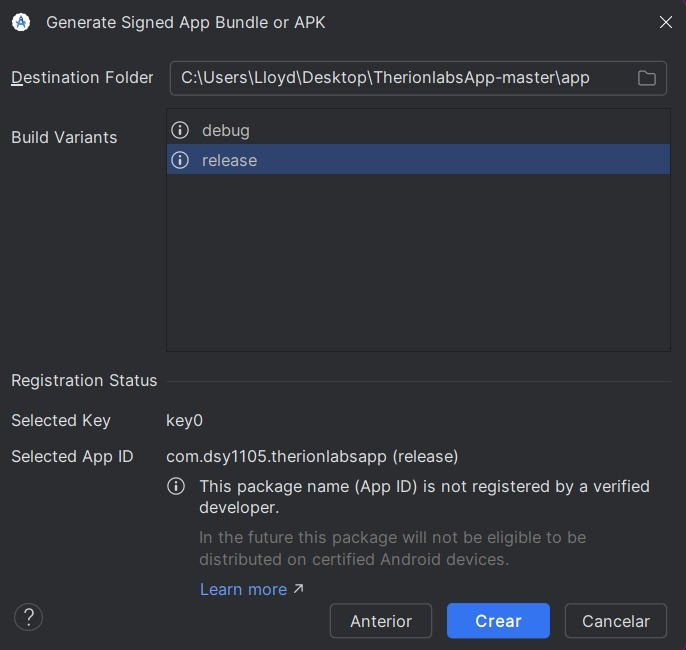

# TherionLabs

## 1. Nombre del proyecto

**TherionLabs**

## 2. Integrantes

- Juan Roldan
- Denirson Lloyd

## 3. Funcionalidades

- Registro e inicio de sesión de usuarios.
- Validación de los datos ingresados en los formularios.
- Registro de prospectos y postulaciones académicas.
- Captura y adjunto de una fotografía del postulante.
- Consulta y seguimiento del estado de las postulaciones.
- Panel de administración para revisar, buscar y gestionar registros.
- Almacenamiento local de información mediante Room.
- Sincronización de registros pendientes con los microservicios cuando existe conectividad.
- Consulta de feriados de Chile mediante la API externa Nager.Date.
- Exportación de información de registros a formato CSV.

## 4. Endpoints utilizados

### Microservicio de usuarios

**Base URL:** `http://107.21.117.137:8081/`

| Método | Endpoint |
|---|---|
| GET | `/api/usuarios` |
| GET | `/api/usuarios/{id}` |
| GET | `/api/usuarios/correo/{correo}` |
| POST | `/api/usuarios` |
| PUT | `/api/usuarios/{id}` |
| DELETE | `/api/usuarios/{id}` |

### Microservicio de postulaciones

**Base URL:** `http://107.21.117.137:8082/`

| Método | Endpoint |
|---|---|
| GET | `/api/postulaciones` |
| GET | `/api/postulaciones/usuario/{usuarioId}` |
| GET | `/api/postulaciones/{id}` |
| POST | `/api/postulaciones` |
| PUT | `/api/postulaciones/{id}` |
| PUT | `/api/postulaciones/{id}/estado` |
| POST | `/api/postulaciones/{id}/foto` |
| GET | `/api/postulaciones/{id}/foto` |
| DELETE | `/api/postulaciones/{id}` |

### API externa: Nager.Date

Consulta de feriados públicos de Chile:

`GET https://date.nager.at/api/v3/PublicHolidays/{anio}/CL`

## 5. Pasos para ejecutar

1. Clonar o descargar el repositorio.
2. Abrir la carpeta principal del proyecto en Android Studio.
3. Esperar a que finalice la sincronización de Gradle.
4. Revisar `app/src/main/java/com/dsy1105/therionlabsapp/api/ApiCliente.kt` y confirmar que las direcciones configuradas correspondan a los microservicios.
5. Iniciar un emulador o conectar un dispositivo Android.
6. Ejecutar la configuración `app` desde Android Studio.

## 6. Capturas del APK firmado y archivo JKS

### 6.1 Creación del almacén de claves

### 6.2 Selección de la llave y variante Release

### 6.3 APK generado

