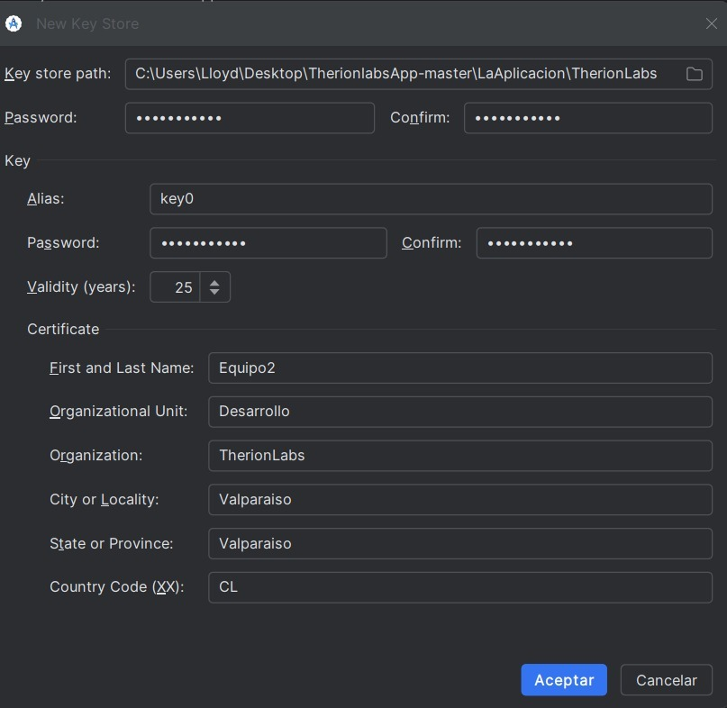
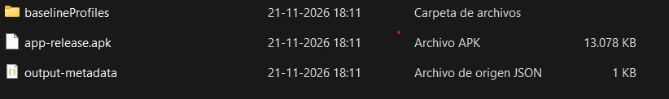

# TherionLabs

Aplicación móvil Android para el registro, seguimiento y administración de prospectos y postulaciones académicas. El proyecto combina almacenamiento local, sincronización con servicios backend desarrollados en Spring Boot y consulta de información externa sobre feriados de Chile.

## 1. Nombre del proyecto

**TherionLabs**

## 2. Integrantes

- Juan Roldan
- Denirson Lloyd

## 3. Descripción general

TherionLabs permite registrar y administrar prospectos interesados en una institución académica. La aplicación está desarrollada para Android y utiliza Kotlin con Jetpack Compose para construir sus interfaces.

La solución contempla almacenamiento local mediante Room, comunicación con microservicios REST desarrollados con Spring Boot y una API externa para consultar los feriados oficiales de Chile.

## 4. Funcionalidades principales

- Registro e inicio de sesión de usuarios.
- Validación de los datos ingresados en los formularios.
- Registro de prospectos y postulaciones académicas.
- Captura y adjunto de una fotografía del postulante.
- Consulta y seguimiento del estado de las postulaciones.
- Panel de administración para revisar, buscar y gestionar registros.
- Almacenamiento local de información mediante Room.
- Sincronización de registros pendientes con los microservicios cuando existe conectividad.
- Consulta de feriados de Chile mediante la API externa Nager.Date.
- Exportación de información de registros a formato CSV.
- Separación de responsabilidades entre interfaz, lógica de negocio, almacenamiento y comunicación con servicios.

## 5. Tecnologías utilizadas

| Tecnología | Uso |
|---|---|
| Kotlin | Lenguaje principal de Android |
| Android Studio | Entorno de desarrollo |
| Jetpack Compose | Construcción de interfaces |
| Material 3 | Componentes visuales |
| Room | Persistencia local de datos |
| Retrofit | Consumo de servicios REST |
| OkHttp | Comunicación HTTP |
| Spring Boot | Desarrollo de microservicios |
| Java 17 | Ejecución de los microservicios |
| Maven | Construcción y gestión de dependencias backend |
| H2 | Base de datos utilizada por los microservicios |
| AWS EC2 | Despliegue de los microservicios |
| Nager.Date | Consulta de feriados públicos de Chile |

## 6. Arquitectura y estructura del proyecto

El proyecto se organiza en una aplicación Android y dos microservicios independientes.

```text
TherionlabsApp/
│
├── app/
│   └── src/
│       ├── main/
│       │   ├── java/com/dsy1105/therionlabsapp/
│       │   │   ├── api/                 # Retrofit y modelos de comunicación
│       │   │   ├── datos/               # Room, entidades, DAO y repositorios
│       │   │   ├── interfaz/            # Pantallas, ViewModels y validaciones
│       │   │   ├── interfazAdmin/       # Componentes e interfaces administrativas
│       │   │   └── ui/theme/            # Tema y configuración visual
│       │   └── res/                     # Recursos gráficos y configuración Android
│       ├── test/                        # Pruebas unitarias
│       └── androidTest/                 # Pruebas instrumentadas
│
├── backend/
│   ├── usuarios-service/
│   │   └── src/main/java/cl/therionlabs/usuarios/
│   │       ├── controller/              # Endpoints REST de usuarios
│   │       ├── model/                   # Entidad Usuario
│   │       └── repository/              # Acceso a datos
│   │
│   └── postulaciones-service/
│       └── src/main/java/cl/therionlabs/postulaciones/
│           ├── controller/              # Endpoints REST de postulaciones
│           ├── model/                   # Entidad Postulacion
│           └── repository/              # Acceso a datos
│
├── gradle/
├── README.md
└── settings.gradle.kts
```

### Responsabilidad de los componentes

- **api:** contiene la configuración de Retrofit, los modelos de intercambio de datos y las interfaces para consumir los servicios.
- **datos:** contiene las entidades, DAO, base de datos Room y repositorios encargados de administrar la información local y su sincronización.
- **interfaz:** contiene las pantallas de la aplicación, ViewModels y reglas de validación.
- **interfazAdmin:** contiene los componentes correspondientes a la administración.
- **backend/usuarios-service:** administra las operaciones relacionadas con usuarios.
- **backend/postulaciones-service:** administra postulaciones, estados y fotografías adjuntas.

## 7. Endpoints utilizados

Las siguientes direcciones corresponden al despliegue configurado actualmente en AWS EC2.

### Microservicio de usuarios

**Base URL:** `http://107.21.117.137:8081/`

| Método | Endpoint | Descripción |
|---|---|---|
| GET | `/api/usuarios` | Listar usuarios |
| GET | `/api/usuarios/{id}` | Consultar un usuario por ID |
| GET | `/api/usuarios/correo/{correo}` | Buscar un usuario por correo |
| POST | `/api/usuarios` | Registrar un usuario |
| PUT | `/api/usuarios/{id}` | Actualizar los datos de un usuario |
| DELETE | `/api/usuarios/{id}` | Eliminar un usuario |

### Microservicio de postulaciones

**Base URL:** `http://107.21.117.137:8082/`

| Método | Endpoint | Descripción |
|---|---|---|
| GET | `/api/postulaciones` | Listar postulaciones |
| GET | `/api/postulaciones/usuario/{usuarioId}` | Listar postulaciones asociadas a un usuario del servidor |
| GET | `/api/postulaciones/{id}` | Consultar una postulación por ID |
| POST | `/api/postulaciones` | Crear una postulación |
| PUT | `/api/postulaciones/{id}` | Actualizar una postulación |
| PUT | `/api/postulaciones/{id}/estado` | Cambiar el estado de una postulación |
| POST | `/api/postulaciones/{id}/foto` | Subir una fotografía mediante multipart, campo `foto` |
| GET | `/api/postulaciones/{id}/foto` | Obtener la fotografía de una postulación |
| DELETE | `/api/postulaciones/{id}` | Eliminar una postulación |

Los estados contemplados por el microservicio son `Recibida`, `En revisión`, `Aceptada` y `Rechazada`.

La fotografía se envía en una solicitud independiente después de crear la postulación. El backend admite imágenes JPG y PNG de hasta 5 MB.

### API externa: feriados de Chile

La aplicación consulta los feriados públicos mediante Nager.Date.

**Solicitud:**

```http
GET https://date.nager.at/api/v3/PublicHolidays/{anio}/CL
```

El parámetro `{anio}` corresponde al año que se desea consultar y `CL` identifica a Chile.

## 8. Validaciones de datos

La aplicación incorpora validaciones antes de guardar los datos del formulario.

| Campo | Validación |
|---|---|
| Nombre | Debe tener al menos 3 caracteres, incluir letras y no contener números |
| RUT | Se comprueba el formato y el dígito verificador mediante el algoritmo módulo 11 |
| Fecha de nacimiento | Debe respetar el formato `dd/MM/yyyy`, corresponder a una fecha real y no ser futura |
| Correo electrónico | Debe cumplir un formato de correo válido |
| Teléfono | Se valida como número celular chileno de 9 dígitos; también admite el prefijo `56` |
| Dirección | Debe contener al menos 5 caracteres |

**Formato recomendado para ingresar los datos:**

- RUT: `12.345.678-5`
- Fecha de nacimiento: `01/01/2000`

La validación del RUT acepta el ingreso con o sin puntos y comprueba el dígito verificador. La fecha de nacimiento se valida actualmente en la aplicación Android y se conserva en el registro local Room.

**Importante:** en la versión actual, el modelo de envío de postulaciones al microservicio incluye el RUT, pero no incluye la fecha de nacimiento. Por lo tanto, la fecha se guarda en el almacenamiento local del dispositivo y no se envía al backend de postulaciones.

## 9. Almacenamiento y sincronización

La aplicación utiliza Room para mantener registros en el dispositivo. Esto permite conservar la información localmente y continuar trabajando aunque no exista conexión con el servidor.

Los registros pueden quedar pendientes de sincronización. Cuando se recupera la conectividad, el repositorio intenta enviarlos a los microservicios y actualiza su estado de sincronización.

Los microservicios mantienen sus propios datos en el backend. En el servicio de postulaciones, las fotografías se almacenan como archivos en el directorio configurado para fotos, mientras que la base de datos conserva la referencia al archivo.

## 10. Requisitos previos

### Aplicación Android

- Android Studio.
- SDK de Android requerido por la configuración del proyecto.
- Gradle y los complementos descargados durante la sincronización.
- Emulador Android o dispositivo físico compatible.

### Microservicios

- Java 17.
- Maven.
- Acceso a la instancia AWS EC2 o un entorno local.
- Puertos `8081` y `8082` disponibles para los servicios.

## 11. Pasos para ejecutar el proyecto

### Aplicación Android

1. Clonar o descargar el repositorio.
2. Abrir la carpeta principal del proyecto en Android Studio.
3. Esperar a que finalice la sincronización de Gradle.
4. Revisar `app/src/main/java/com/dsy1105/therionlabsapp/api/ApiCliente.kt` y confirmar que las direcciones configuradas correspondan al servidor que se utilizará.
5. Iniciar un emulador o conectar un dispositivo Android.
6. Ejecutar la configuración `app` desde Android Studio.

### Ejecutar los microservicios en AWS EC2

Los dos servicios se ejecutan de manera independiente en la instancia EC2.

**Microservicio de usuarios:**

```bash
cd backend/usuarios-service
mkdir -p datos
mvn clean package -DskipTests
nohup java -jar target/usuarios-service-1.0.0.jar > app.log 2>&1 &
```

**Microservicio de postulaciones:**

```bash
cd backend/postulaciones-service
mkdir -p datos/fotos
mvn clean package -DskipTests
nohup java -jar target/postulaciones-service-1.0.0.jar > app.log 2>&1 &
```

El microservicio de usuarios utiliza el puerto `8081` y el microservicio de postulaciones utiliza el puerto `8082`. El grupo de seguridad de AWS EC2 debe permitir el tráfico necesario hacia esos puertos. Para un despliegue real, se recomienda restringir el acceso a los orígenes autorizados y utilizar HTTPS.

### Ejecutar los microservicios localmente en Windows

1. Abrir una terminal en la carpeta `backend/usuarios-service`.
2. Ejecutar:

```bash
mvn spring-boot:run
```

3. Abrir una segunda terminal en `backend/postulaciones-service`.
4. Ejecutar:

```bash
mvn spring-boot:run
```

5. Para probar desde un emulador Android, configurar las direcciones de `ApiCliente.kt` según el entorno. En el emulador estándar de Android, el host de la computadora suele alcanzarse mediante `10.0.2.2`; desde un dispositivo físico se debe utilizar la dirección IP local del computador.

## 12. Pruebas

El proyecto contiene pruebas automatizadas en los directorios:

- `app/src/test/`: pruebas unitarias de la lógica de la aplicación, validaciones y repositorios.
- `app/src/androidTest/`: pruebas instrumentadas que se ejecutan en un dispositivo o emulador.
- `backend/usuarios-service/src/test/`: pruebas del microservicio de usuarios.
- `backend/postulaciones-service/src/test/`: pruebas del microservicio de postulaciones.

Para ejecutar las pruebas de Android desde la terminal:

```bash
./gradlew test
```

En Windows:

```powershell
.\gradlew.bat test
```

Para ejecutar las pruebas de cada microservicio, ingresar a su respectiva carpeta y ejecutar:

```bash
mvn test
```

## 13. Generación del APK firmado

Para generar una versión release firmada:

1. Abrir el proyecto en Android Studio.
2. Seleccionar **Build > Generate Signed Bundle / APK**.
3. Seleccionar **APK** y continuar.
4. Crear o seleccionar el archivo de clave (`.jks`).
5. Completar la contraseña del almacén de claves, el alias y la contraseña de la clave.
6. Seleccionar la variante `release`.
7. Finalizar el asistente y esperar la generación del APK.
8. Android Studio mostrará la ubicación del APK firmado.

**Seguridad:** el archivo `.jks`, sus contraseñas y las claves privadas no deben publicarse en GitHub ni compartirse en el repositorio. Mantener una copia de respaldo segura. Si se necesita documentar la firma, publicar capturas del procedimiento ocultando contraseñas, alias sensibles y cualquier dato privado.

## 14. Capturas del APK firmado y archivo JKS

### 14.1 Creación de la clave de firma

Esta captura muestra el proceso de creación de la clave utilizada para firmar la aplicación Android.



### 14.2 Selección de la variante Release

Esta captura muestra la selección de la variante Release durante la generación del APK firmado.


### 14.3 APK firmado y archivo JSON

Esta captura muestra los archivos generados al finalizar el proceso de compilación y firma de la aplicación.


## 15. Publicación en GitHub

Una vez actualizados los archivos y agregadas las capturas, ejecutar desde la carpeta principal:

```bash
git add README.md docs/images/
git commit -m "Actualizar documentación del proyecto"
git push
```

## 16. Consideraciones de seguridad y configuración

- No publicar archivos `.jks`, contraseñas, tokens ni claves privadas.
- No utilizar datos personales reales en capturas de demostración.
- Revisar las direcciones IP y puertos antes de ejecutar la aplicación.
- Para producción, configurar HTTPS y restringir el acceso a los servicios.
- La dirección IP pública incluida en la configuración puede cambiar si la instancia EC2 no utiliza una IP elástica.
- La fecha de nacimiento se valida y almacena localmente en esta versión; para sincronizarla con el servidor se debe agregar el campo correspondiente al contrato de la API y al modelo backend.

## 17. Autores

**Juan Roldan**  
**Denirson Lloyd**

Proyecto académico desarrollado con fines de aprendizaje e implementación de una solución móvil conectada a microservicios.

DENIRSON
